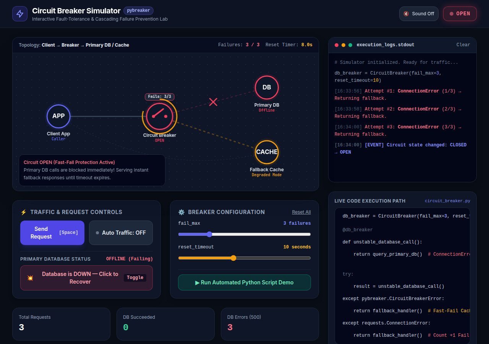
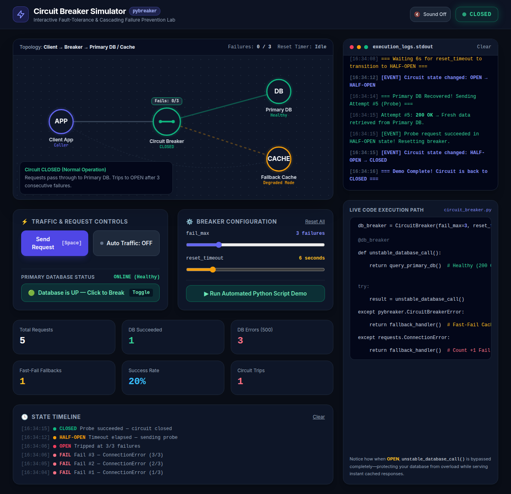
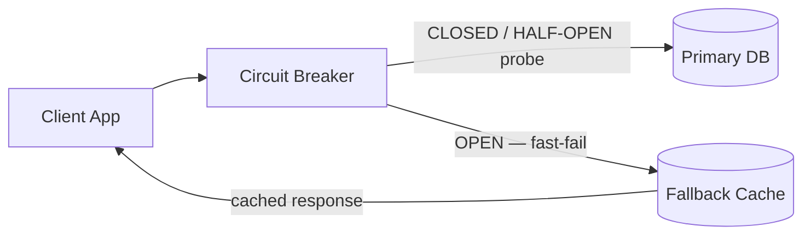
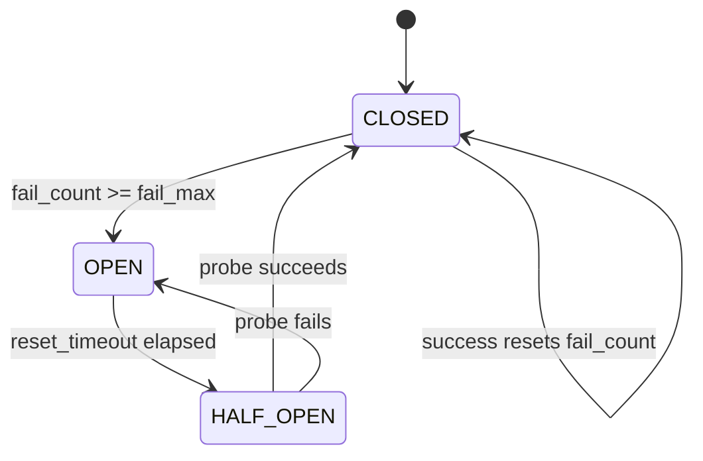

# Circuit Breaker Pattern Simulator

An interactive fault-tolerance lab that makes the Circuit Breaker pattern
visible. Requests travel as animated packets from a client app through a
breaker to a primary database — or, when the breaker trips, fast-fail to a
fallback cache. Inspired by the Python library
[pybreaker](https://github.com/danielfm/pybreaker).



**Video walkthrough** — a 10-second AI-avatar teaser of the simulator:
[avatar-teaser-10s.mp4](shots/avatar-teaser-10s.mp4) (the on-screen label
reads "SIMULATION OF ROBERT BOSTICK - AI GENERATED AVATAR")

## What it demonstrates

- **CLOSED** — requests flow to the primary database; consecutive failures
  are counted up to `fail_max`.
- **OPEN** — after `fail_max` consecutive failures the breaker trips.
  Requests stop hitting the database entirely and are served instantly
  from the fallback cache (fast-fail). A red X marks the severed wire.
- **HALF-OPEN** — after `reset_timeout` seconds a single probe request is
  allowed through. Success closes the circuit; failure re-opens it at once.

## Features

- Real-time packet visualization on an HTML5 canvas (client → breaker →
  primary DB / fallback cache), with a mechanical switch and a countdown
  ring while OPEN
- Live execution console with timestamps
- Synchronized Python code view — the active `pybreaker` code path
  highlights as requests flow, then fades like a debugger stepping
- State timeline — timestamped trips, probe outcomes, failures and DB
  health changes, newest on top
- Metrics: total requests, DB successes, DB errors, fast-fail fallbacks,
  success rate, circuit trips
- Configurable `fail_max` (1–10) and `reset_timeout` (3–20s) sliders
- Primary database health toggle (break it / recover it)
- Auto traffic mode, Spacebar to send a request, procedural sound effects
  (Tone.js, off by default)
- Automated Python script demo — trips the breaker, waits out the timeout,
  recovers the DB and probes back to CLOSED
- Frame-rate independent animation, bounded console (200 lines) and
  timeline (50 rows), packet cap (100 in flight)



## Run it

No build step. The simulator is a single static file (`index.html`) plus
its CDN dependencies (Tailwind CSS, Google Fonts, Tone.js), so it needs
internet access for full styling and sound.

**Open it directly** — double-click `index.html`, or serve it locally:

```bash
python3 -m http.server 8000
# then open http://localhost:8000
```

**GitHub Pages** — push this folder to a repository, then in the repo go to
Settings → Pages → Build and deployment → Deploy from a branch → select
the branch and `/ (root)` → Save. The simulator is live at
`https://<username>.github.io/<repo>/` within a minute or two.

## How to use it

1. The database starts **DOWN**, so the first three requests fail and trip
   the breaker. Watch the switch lift and the X appear on the DB wire.
2. Send another request while OPEN — it fast-fails to cache instantly.
3. Wait out the timeout (or lower `reset_timeout`) to reach HALF-OPEN.
4. Click **Database is DOWN — Click to Recover**, then send a probe to
   close the circuit.
5. Or press **Run Automated Python Script Demo** and watch the whole
   cycle play out on its own.
6. **Reset All** restores the initial state, including the DB and both
   sliders — and cancels a running demo.

## Architecture





The state machine mirrors `pybreaker`: the decorated call raises
`CircuitBreakerError` while OPEN (fast-fail path) and
`requests.ConnectionError` on a failed database call (failure counting
path). One in-flight request past the breaker is never recalled when the
breaker trips — it completes at the database.

## Project layout

```text
index.html                  The simulator (single file)
index.original.html         The original file, before polishing
LICENSE                     MIT
README.md                   This file
POLISH-NOTES.md             What changed during polishing, and why
playtest.js                 Headless-Chromium playtest (42 checks)
shots/                      Screenshots (styled + headless captures)
```

## Browser testing

| Browser | Status |
| --- | --- |
| Chrome (desktop) | Tested — full playtest passes (state machine, demo, reset, caps) |
| Edge (desktop) | Shares the Chromium engine with Chrome — not run separately |
| Firefox (desktop) | Not tested yet |
| Mobile Safari | Not tested yet |

## Credits

- [Tailwind CSS](https://tailwindcss.com/) — styling
- [Tone.js](https://tonejs.github.io/) — procedural sound effects
- [pybreaker](https://github.com/danielfm/pybreaker) — the pattern and
  code mapping this simulator teaches
- Fonts: Inter and JetBrains Mono (Google Fonts)

## License

MIT — see [LICENSE](LICENSE).
